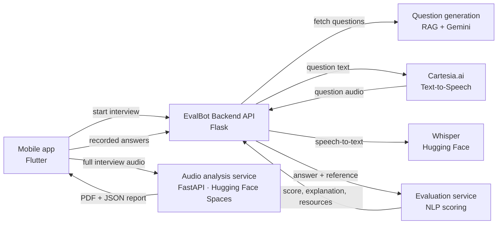

# EvalBot — Backend API

**EvalBot** is an AI-powered interview evaluation system: it runs spoken interviews, analyzes the candidate's recorded answers, and produces a detailed feedback report. It serves recruiters (faster, more consistent screening) and job seekers (a virtual interview coach).

This repository holds:
- the **Flask backend API** (root folder) that orchestrates the interview flow and connects the system's services: the mobile app, question generation, text-to-speech, speech-to-text, and answer evaluation
- the **audio analysis service** ([`audio_analysis/`](audio_analysis/)) that analyzes a recorded interview and produces the PDF report

> Bachelor's graduation project, Scientific Computing Department, Faculty of Computers and Artificial Intelligence, Benha University (June 2025). Supervised by Dr. Eman Monir.

---

## System architecture



### Audio analysis service ([`audio_analysis/`](audio_analysis/))

A FastAPI service, deployed with Docker on Hugging Face Spaces, that turns a full interview recording into a candidate report. It also has a web page where anyone can upload a recording and try it.

1. Audio conversion to 16 kHz mono WAV (ffmpeg)
2. Speech-to-text with speaker diarization (AssemblyAI)
3. Prosodic features per utterance: pitch and intensity (librosa)
4. Speaker identification: NVIDIA NeMo TitaNet embeddings matched against and enrolled into a Pinecone vector index
5. Role classification (interviewer vs. interviewee): Random Forest trained on ~3,000 labeled utterances from the MIT Interview dataset (~92% held-out accuracy), aggregated per speaker
6. Voice analysis: speaking rate, filler words, repetition, pitch, jitter/shimmer, and confidence / anxiety / hesitation scores
7. Evaluation: Gemini returns a structured assessment (strengths with evidence, development areas, role fit, recommendations, content score)
8. Report: multi-page PDF with charts and an annotated transcript (ReportLab, Matplotlib), plus JSON

**Live demo:** [huggingface.co/spaces/EvalBot/Audio-EvalBot](https://huggingface.co/spaces/EvalBot/Audio-EvalBot). It's on free hardware, so the first request after it has been idle takes a minute to wake it up.

---

## API endpoints

### `POST /api/start-interview`

Fetches questions from the question generation service, converts each one to speech with Cartesia.ai, and returns the questions with their audio URLs.

```json
// request
{ "track_id": "1", "difficulty": "beginner", "num_questions": 3 }

// response
{
  "status": "success",
  "interview_data": {
    "total_questions": 3,
    "questions": [
      {
        "id": 1,
        "question_number": 1,
        "question_text": "What is the purpose of a confusion matrix?",
        "audio_url": "/static/audio/question_1749062113462_0.wav",
        "gemini_answer": "...",
        "question_topic": "machine learning",
        "question_classification": "Beginner"
      }
    ]
  }
}
```

### `POST /api/submit-answers`

Takes a list of recorded answers. For each answer it downloads the audio, transcribes it with Whisper, and sends the transcript with the reference answer to the evaluation service.

```json
// request
[
  {
    "question_id": "1",
    "question_text": "What is the purpose of a confusion matrix?",
    "gemini_answer": "...",
    "question_topic": "machine learning",
    "classification": "Beginner",
    "audio_url": "https://.../answer_1.wav"
  }
]

// response
[
  {
    "question_id": "1",
    "status": "success",
    "transcribed_text": "...",
    "evaluation_result": {
      "score": "...",
      "score_explanation": "...",
      "links": ["..."],
      "question_topic": "machine learning",
      "question_classification": "Beginner"
    }
  }
]
```

### `GET /static/<path>`

Serves the generated question audio files.

---

## Running locally

**Requirements:** Python 3.9+

```bash
git clone https://github.com/nourhan-shalaby/EvalBot-Backend-API.git
cd EvalBot-Backend-API

python -m venv venv
source venv/bin/activate        # Windows: .\venv\Scripts\activate
pip install -r requirements.txt

cp .env.example .env            # then fill in your keys and service URLs
python app.py                   # http://localhost:5001
```

The Whisper model downloads on first run. To try the answer flow, run `python test_submit.py` with the API running.

**Production:** the included `Procfile` runs the app with `gunicorn app:app`.

### Environment variables

| Variable | Purpose |
|---|---|
| `CARTESIA_API_KEY` | Cartesia.ai text-to-speech |
| `CARTESIA_TTS_MODEL_ID`, `CARTESIA_TTS_VOICE_ID` | TTS model and voice (defaults provided) |
| `HF_STT_MODEL_NAME` | Whisper model (default `openai/whisper-tiny`) |
| `API_BASE_URL` | Question generation service |
| `EXTERNAL_EVALUATION_API_URL` | Answer evaluation service |
| `PORT`, `FLASK_DEBUG` | Server port (default 5001) and debug mode (default off) |

---

## Tech stack

Python · Flask · FastAPI · Hugging Face Transformers (Whisper) · Cartesia.ai · AssemblyAI · NVIDIA NeMo · Pinecone · librosa · scikit-learn · Gemini API · ReportLab · Docker · Hugging Face Spaces

## Related repositories

- Mobile app (Flutter): [Mohamed-Essam-Mohamed/EVALBOT-APP](https://github.com/Mohamed-Essam-Mohamed/EVALBOT-APP)
- Database: [MHMD-SAYID/GraduationProject](https://github.com/MHMD-SAYID/GraduationProject)

## Team

**Backend APIs, system integration & audio analysis:** Nourhan Saber Shalaby

Mohamed Mahmoud Mohamed · Mohamed Sayid Mohamed · Mohamed Mohamed Barakat · Mohamed Adel Hosny · Mohamed Essam Mohamed · Mohamed Mostafa Salama · Amr Mohamed Ahmed · Ibrahim Ahmed Mohamed · Elzahraa Eslam Marzouk

Supervised by **Dr. Eman Monir**, with Eng. Esraa Taher and Eng. Eman Naser.
